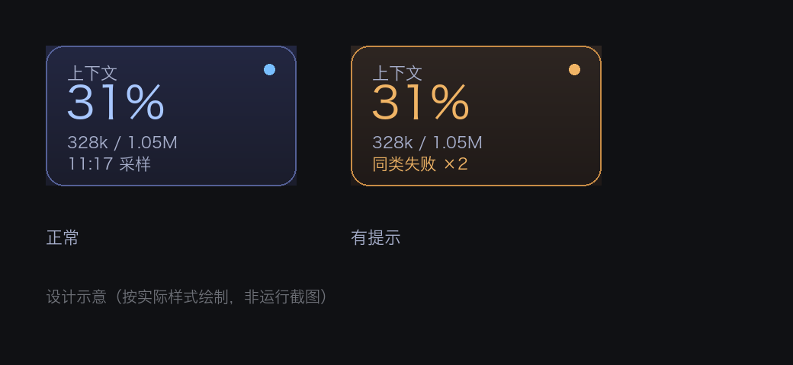

# DSH 会话状态看板

English | [简体中文](README.md)

给 DeepSeek Harness（DSH）用的一个悬浮小卡片：**显示当前会话的上下文占用，并在两类情况亮黄点**——同一工具连续失败、任务长时间没有结束。点开能看到证据，所有数字都来自本地会话日志。



> 设计示意（按实际样式绘制，不是运行截图）。

## 它显示什么

| 状态 | 卡片 | 说明 |
|---|---|---|
| 正常 | `上下文 31%` | 最近一次请求的输入上下文占窗口的比例 |
| 采样超过 90 秒 | 数字降到 60% 透明度 | 数据旧了，但不清零 |
| 压缩中 | `更新中` + `压缩进行中` | 压缩期间不沿用旧值 |
| 压缩结束/换模型 | `等待下一次请求` | 旧快照已失效 |
| 同类失败 ≥2 次 | 黄边 + `同类失败 ×2` | 同一工具、同一错误类别，跨目标合并计数 |
| 任务 >300 秒没终态 | `任务状态待确认` | 不判断它是否还活着，只说没有结束记录 |
| 记录解析失败 | 末行加 `记录不完整` | 中间有记录读不出来，历史可能缺项 |
| 上下文 ≥50% | 数字变**琥珀** | 只用颜色，不加文字；边框与状态点不受影响 |
| 上下文 ≥65% | 数字变**红** | 同上；自动压缩多数在 65–70% 之间触发，这条线是压缩前最后一个能看见的窗口（具体位置随模型与配置变化） |

点开卡片是一个证据面板：来源采样时间、失败的工具/类别/条数/目标、`seq` 区间、最近 3 条已结束的提示（含结束原因）。

## 它不做什么

- **不判断任务对不对**、不预测还要多久、不评分
- **不主动操作**：不停止、不重试、不触发压缩、不发送任何东西
- **不联网**：只读本机 `~/.dsh/sessions/**/session.v4.jsonl.zstd`，不写任何文件
- 不显示余额/花费（已有专门插件负责，重复只会打架）

## 安装

在 DSH 侧栏 **插件 → 添加插件**，输入下面任一形式：

```
# npm（发布后）
dsh-session-health

# Git
https://github.com/kingrenqi-wq/dsh-session-health

# 本地目录
/绝对/路径/dsh-session-health
```

装完点「立即启用」。装的是链接目录时，改代码后**刷新页面**即可；改宿主半（`index.js`）需要**重启 DSH**。

## 使用

- 卡片默认出现在右下角，**拖动**可放到任意位置，位置记在 `localStorage`
- **点击**打开证据面板，`Esc` 或点外面关闭
- 键盘：Tab 聚焦、Enter/Space 打开

## 数据与判定口径

- 上下文占用 = `totalTokens − outputTokens` / `contextWindow`（最近一次请求的快照）
- 失败只认**结构化**信号：`tool/result.data.error`；shell 工具另按结尾的 `[exit code: N]` 计
- 取消（`aborted`）不算失败
- 长任务提示只在 300 秒～30 分钟之间出现；超过 30 分钟没有新证据就退场进历史
- 会话文件被替换/截断/原地改写时，靠 inode + 游标前缀 sha256 判断并重建缓存

## 已知限制

- 宿主重启、时钟跳变、多窗口、超时合并、分页这几项**未验证**（详见 `docs/PRD.md` §15）
- 浏览器侧依赖 DSH 的 `shell.overlay` 插槽与 `useSessions` 根 hook，升级后可能失效（失效时卡片消失，不影响 DSH 本体）
- 只支持会话格式 v4；格式变化会退化成「不可用」，不会崩

## 开发与测试

```bash
NODE=node   # 需要支持 zstd 的 Node（>=22.13）

$NODE tools/session-health-rules.test.mjs           # 规则回放 27 条
$NODE tools/session-health-faults.test.mjs          # 文件/帧故障 16 条
$NODE tools/session-health-regressions.test.mjs     # 三轮复审反例 30 条
$NODE tools/session-health-ui.test.mjs              # 界面状态 12 条
$NODE tools/session-health-ui-regressions.test.mjs  # 切换/超时 6 条
$NODE tools/session-health-readonly.test.mjs        # 只读审计（冻结副本）
$NODE tools/session-health-probe.mjs <会话id>        # 打一份真实快照
```

共 91 条行为断言 + 只读审计，全部通过。测试用 `DSH_SESSION_HEALTH_ROOT` 指向临时目录，不会碰真实会话。

## 许可

MIT。见 [LICENSE](LICENSE)。
